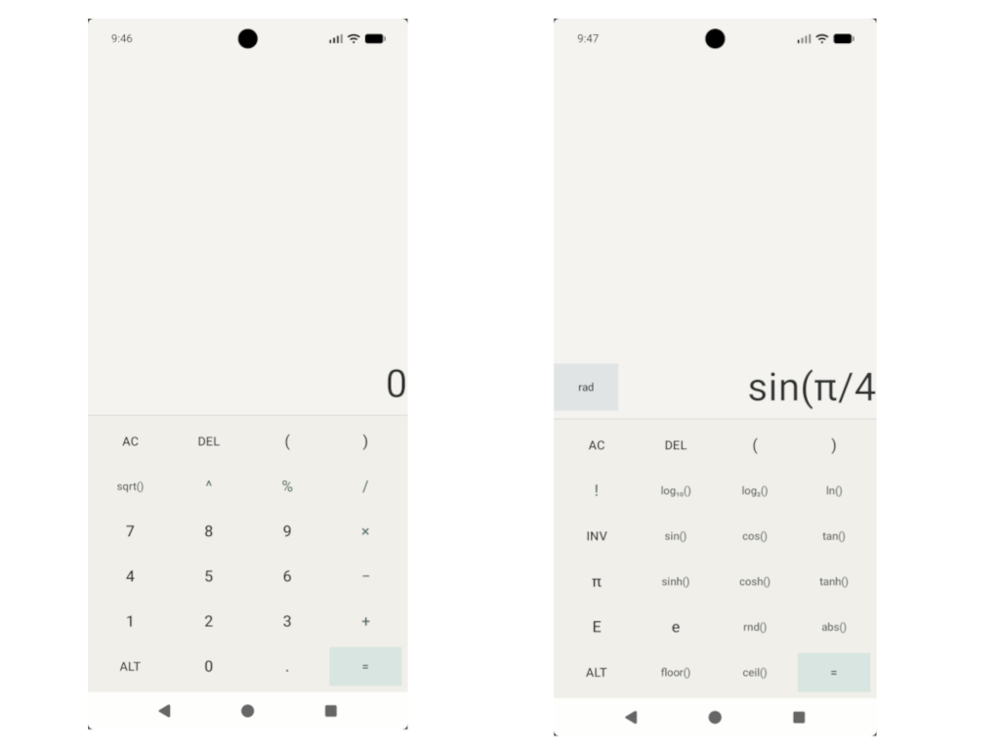

# Calculator

A simple, Android calculator app. FOSS (Free and Open Source), no ads, no tracking.

## Features

- Expression-based calculations (powered by Symja)
- Basic and scientific keypad modes
- Copy result to clipboard
- Light and dark theme

## TODO

- Calculation history
- Internationalization (i18n)

## License

This project is licensed under the [GNU General Public License v3.0](./LICENSE).

Copyright (C) 2026 Furkan Çetinkaya
